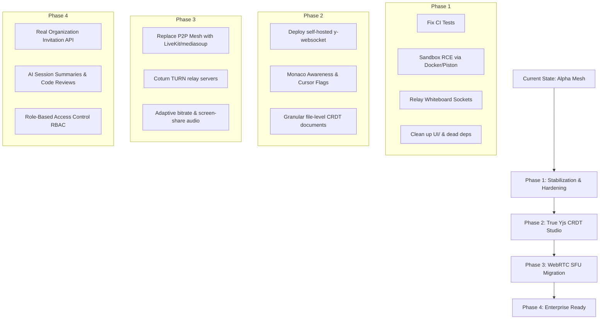

# DEVMEET-2 Comprehensive Codebase Audit & Technical Blueprint

**Audit Date:** October 2026  
**Repository:** `Sid0004/DEVMEET-2`  
**Platform Target:** Real-Time Technical Collaboration & Developer Hiring Workspace  
**Status:** Alpha / Active Development  

---

## 1. Executive Summary: What is DEVMEET?

**DEVMEET** is an ambitious, full-stack real-time collaborative workspace designed for software engineers, distributed tech teams, and technical hiring pipelines. It bridges three traditionally fragmented developer tools into a single browser-based application:

1. **Collaborative Code Studio**: Monaco Editor environment with multi-file management, language syntax highlighting, and code execution.
2. **Audio/Video Conferencing**: Integrated peer-to-peer WebRTC video calling with device selection, green-room audio analysis, and camera/mic sync.
3. **Interactive Visual Canvas**: Real-time whiteboard canvas with geometric tool presets and zero-latency chat messaging.
4. **Developer Auth & Tenancy**: Multi-provider authentication (Local with OTP email verification, Google OAuth2, GitHub OAuth) paired with organization-level team tenancy and personal profiles.

### Architecture Map

```
┌────────────────────────────────────────────────────────────────────────┐
│                          Next.js 16 Frontend                           │
│  ┌───────────────────────┬────────────────────┬──────────────────────┐ │
│  │     Monaco Editor     │   WebRTC Video /   │  Redux Toolkit State │ │
│  │   + Whiteboard Canvas │    Audio Canvas    │     (Auth, Chat)     │ │
│  └───────────┬───────────┴──────────┬─────────┴──────────┬───────────┘ │
└──────────────┼──────────────────────┼────────────────────┼─────────────┘
               │                      │                    │
               │ (WebSocket State)    │ (P2P Mesh Streams) │ (REST APIs)
               │                      │                    │
               │               ┌──────▼──────┐             │
               │               │ WebRTC Mesh │             │
               │               │ (STUN only) │             │
               │               └─────────────┘             │
        ┌──────▼───────────────────────────────────────────▼──────┐
        │                  Express.js 5 Backend                   │
        │  ┌─────────────────────────────┬─────────────────────┐  │
        │  │     Socket.IO Gateway       │   REST Controllers  │  │
        │  │ (Room, Call, Chat, Editor)  │  (Auth, Room, Exec) │  │
        │  └──────────────┬──────────────┴──────────┬──────────┘  │
        └─────────────────┼─────────────────────────┼─────────────┘
                          │                         │
                          └────────────┬────────────┘
                                       │
                                ┌──────▼──────┐
                                │   MongoDB   │
                                └─────────────┘
```

---

## 2. Where is it Currently? (Implementation Status)

| Subsystem | Intended Spec | Current Reality | Status |
| :--- | :--- | :--- | :--- |
| **Authentication & OTP** | Email OTP, Local password, Google, GitHub | Fully implemented in backend & frontend; OTP email via Nodemailer | **85% Complete** (Tests broken) |
| **Landing Page & Marketing** | GitHub Universe / Linear brutalist aesthetic | Three.js dither shaders, Lenis scroll, Torus gyroscope, responsive cards | **95% Complete** (Has 2 React 19 lints) |
| **Lobby & Green Room** | Pre-call device test, audio visualizer | `useUserMedia` and `useAudioAnalyser` working smoothly with live canvas preview | **90% Complete** |
| **Collaborative Editor** | Yjs CRDT + y-monaco + cursor awareness | **CRDT NOT USED in workspace**. Uses whole-file WebSocket replacement string broadcast | **30% Complete** (High latency risk) |
| **Whiteboard Canvas** | Real-time multi-user drawing sync | Client UI works with tool presets, but **Backend drops events** (`whiteboard:draw` unhandled) | **40% Complete** (Sync broken) |
| **WebRTC Media Transport** | Peer-to-peer audio/video calling | Working P2P mesh with dummy track fallbacks; lacks TURN servers and SFU for scale | **70% Complete** |
| **Code Execution Engine** | Sandboxed remote runner | Executes directly on host OS via `child_process.execFile` with `shell: true` | **CRITICAL SECURITY RISK** |
| **Organization & Teams** | Full tenancy, RBAC, member invites | Schemas and onboarding exist; Collaborators page UI is mocked in React local state | **35% Complete** |
| **Automated Testing & CI** | Jest + Supertest CI pipeline | Backend has 4 test suites; **7 tests failing** due to OTP breaking changes | **50% Broken** |

---

## 3. What’s "Fire"? 🔥 (Strengths & Standout Craft)

### 1. Distinctive Visual Identity & Micro-Interactions
Unlike standard cookie-cutter SaaS templates, DEVMEET adopts a distinct **Linear / GitHub Universe brutalist engineering design**:
* **Screen-Space Bayer 8×8 Dither Shader (`DitherReveal.jsx`)**: Custom WebGL fragment shader with dynamic luminance thresholds that responds to cursor proximity.
* **Three.js Torus Gyroscope (`gyro-rings.jsx`)**: Metallic matcap rings with drag inertia decay and responsive resize clamping.
* **Lenis Smooth Scroll Engine**: Exponential wheel dampening with automatic `visibilitychange` frame cancellation to conserve GPU battery life.

### 2. Deep OAuth & Fallback Strategy (`user.service.js`)
* **Google Dual-Mode Verification**: Gracefully handles both Google One-Tap ID Tokens (`client.verifyIdToken`) and standard OAuth2 access tokens (`https://www.googleapis.com/oauth2/v3/userinfo`).
* **GitHub Private Email Resolution**: When a GitHub developer has their email set to private, the backend queries `https://api.github.com/user/emails` to find the primary verified address instead of dropping the registration.
* **Smart Slug & Username Allocation**: Algorithmic collision resolution (e.g., `user_4912` and `myorg-2941`) prevents database unique key constraint violations.

### 3. Production-Ready Green Room Experience (`new/page.jsx`)
* Real-time audio waveform visualizer using the Web Audio API (`AudioContext`, `AnalyserNode`) so users can check microphone gain before entering calls.
* Complete camera and microphone enumeration with custom `LobbyDeviceDropdown` selectors.
* Audio/video dummy track fallbacks: If a developer has no webcam or mic connected, synthetic dummy canvas and oscillator tracks prevent WebRTC SDP negotiation failure.

### 4. Chat Anti-Abuse & Non-Blocking Persistence (`chat.handler.js`)
* In-memory sliding window rate-limiting (`RATE_LIMIT_WINDOW_MS = 3000`, max 5 messages).
* Zero-latency broadcast to peers via `io.to(roomId).emit("receive-message")` before asynchronously persisting to MongoDB, preventing database write latency from blocking user messaging.

---

## 4. What’s Wrong? 🚨 (Bugs, Security Holes & Debt)

### 🚨 Critical Vulnerability 1: Host Remote Code Execution (RCE)
* **File:** [room.controller.js](file:///c:/Users/siddh/OneDrive/Documents/Desktop/Devmeet2/backend/src/modules/room/room.controller.js#L114-L232)
* **Vulnerability:** When code is executed via `/api/v1/rooms/run`, the server writes the code to `backend/temp/run_*` and invokes `child_process.execFile`:
  ```javascript
  if (process.platform === "win32") execOptions.shell = true;
  execFile(executablePath, args, execOptions, ...);
  ```
* **Impact:** There is **NO sandbox** (no Docker container, no isolate, no gVisor, no network restriction). An authenticated user can submit Python (`import os; os.system("...")`) or Node.js (`child_process.execSync(...)`) to read environment variables (including MongoDB credentials), modify host files, launch reverse shells, or crash the server.
* **Missing Dependency:** In line 141, TypeScript execution attempts to use `node_modules/.bin/tsx`, which is **not installed** in `backend/package.json`.

---

### 🚨 Critical Flaw 2: The "CRDT Illusion" & Race Conditions
* **Files:** [workspace/page.jsx](file:///c:/Users/siddh/OneDrive/Documents/Desktop/Devmeet2/frontend/src/app/workspace/page.jsx#L1091-L1110) vs [ExperimentalYjsEditor.jsx](file:///c:/Users/siddh/OneDrive/Documents/Desktop/Devmeet2/frontend/src/components/ExperimentalYjsEditor.jsx)
* **The Claim:** The README documents "Conflict-free Replicated Data Types (CRDTs) via Yjs (`yjs`, `y-monaco`, `y-webrtc`) with cursor tracking."
* **The Reality:** 
  1. `ExperimentalYjsEditor.jsx` is an unreferenced orphan file connecting to an unstable external demo server (`wss://signaling.yjs.dev`).
  2. The actual workspace uses **naive full-string replacement**:
     ```javascript
     // On every single keystroke:
     socketRef.current.emit("files-change", { files: updated, activeFileIndex });
     ```
  3. The backend receives `files-change` and performs a database write (`Room.findOneAndUpdate`) on every keystroke!
  4. **Active Tab Hijacking**: When User A switches tabs in the editor:
     ```javascript
     socketRef.current.emit("files-change", { files, activeFileIndex: index });
     ```
     This fires `files-update` on all peers and forcibly switches the active file for User B, preventing developers from working on different files simultaneously!

---

### 🚨 Bug 3: Whiteboard Events Dropped by Backend
* **Files:** [WorkspaceWhiteboard.jsx](file:///c:/Users/siddh/OneDrive/Documents/Desktop/Devmeet2/frontend/src/components/workspace/WorkspaceWhiteboard.jsx#L117-L124) vs [backend/src/socket/index.js](file:///c:/Users/siddh/OneDrive/Documents/Desktop/Devmeet2/backend/src/socket/index.js)
* **The Bug:** `WorkspaceWhiteboard.jsx` emits:
  `socket.emit("whiteboard:draw", ...)` and `socket.emit("whiteboard:clear")`.
  However, the backend has **zero event handlers** for `whiteboard:draw` or `whiteboard:clear`. The socket server silently ignores them, rendering the whiteboard 100% single-player.

---

### 🚨 Bug 4: 7 Failing Automated Tests in CI
* **File:** [user.api.test.js](file:///c:/Users/siddh/OneDrive/Documents/Desktop/Devmeet2/backend/src/modules/user/__tests__/user.api.test.js)
* **Root Cause:** Commit `36290b3` introduced mandatory OTP validation into `registerUser`. However, the test payloads in `user.api.test.js` were never updated to include `otp`. As a result, 7 registration test assertions fail with `400 Bad Request` ("All required fields (including OTP) must be filled").

---

### 🚨 Bug 5: Next.js 16 / React 19 Lint & Build Blockers
* **Files:**
  1. [LegalModal.jsx:12](file:///c:/Users/siddh/OneDrive/Documents/Desktop/Devmeet2/frontend/src/components/LegalModal.jsx#L12): `setActiveTab(initialTab)` called synchronously inside `useEffect` triggers `react-hooks/set-state-in-effect` error.
  2. [Agenda.jsx:93-94](file:///c:/Users/siddh/OneDrive/Documents/Desktop/Devmeet2/frontend/src/components/landing/Agenda.jsx#L93-L94): `containerRef.current.clientWidth` accessed directly inside the render phase violates React 19 concurrent render rules (`react-hooks/refs`).
* **Impact:** `npm run build` will fail in production.

---

### ⚠️ Bug 6: WebRTC NAT Traversal (No TURN Server)
* **File:** [workspace/page.jsx:29-35](file:///c:/Users/siddh/OneDrive/Documents/Desktop/Devmeet2/frontend/src/app/workspace/page.jsx#L29-L35)
* `rtcConfig` only specifies Google STUN servers (`stun:stun.l.google.com:19302`). STUN can only discover public IP addresses; it cannot relay packets when clients are behind symmetric NATs or corporate firewalls (~18% of global connections). A TURN server is mandatory for production WebRTC.

---

### ⚠️ Architectural Debt 7: Mocked Dashboard Features
* **Collaborators Page ([page.jsx](file:///c:/Users/siddh/OneDrive/Documents/Desktop/Devmeet2/frontend/src/app/dashboard/collaborators/page.jsx)):** Member invitations only push into local React component state; refreshing the browser discards the invited users.
* **Sessions History ([page.jsx](file:///c:/Users/siddh/OneDrive/Documents/Desktop/Devmeet2/frontend/src/app/dashboard/sessions/page.jsx)):** Deleting a room records the ID in the browser's `localStorage` rather than calling `DELETE /api/v1/rooms/:roomId/delete`.

---

### ⚠️ Repo Cleanliness & Hygiene
1. **Redundant `UI/` Directory:** A duplicate 65MB+ Vite project exists at the repo root.
2. **Dead Dependencies in Backend:** `prisma` and `@prisma/client` are installed despite Mongoose being the active ORM.
3. **Deprecated `crypto` Package:** Installed in `backend/package.json` despite `crypto` being a Node.js standard built-in.

---

## 5. Concrete Solutions & Immediate Fixes

### Fix 1: Add Missing Whiteboard Handlers to Backend
Create/register a whiteboard handler in [backend/src/socket/index.js](file:///c:/Users/siddh/OneDrive/Documents/Desktop/Devmeet2/backend/src/socket/index.js):

```javascript
// In socket connection:
socket.on("whiteboard:draw", (data) => {
  const roomId = socket.data.roomId;
  if (roomId) {
    socket.to(roomId).emit("whiteboard:draw", data);
  }
});

socket.on("whiteboard:clear", () => {
  const roomId = socket.data.roomId;
  if (roomId) {
    socket.to(roomId).emit("whiteboard:clear");
  }
});
```

---

### Fix 2: Prevent Tab Hijacking & Debounce Editor Saves
1. Decouple active tab switching from peer broadcast so User A switching files does not force User B to switch:
   ```javascript
   // Only emit content changes, never activeFileIndex sync across peers
   socketRef.current.emit("file-content-change", {
     fileIndex: activeFileIndex,
     content: value
   });
   ```
2. Debounce MongoDB updates in [editor.handler.js](file:///c:/Users/siddh/OneDrive/Documents/Desktop/Devmeet2/backend/src/modules/editor/editor.handler.js) so the database is updated every 3-5 seconds rather than on every keystroke.

---

### Fix 3: Sandbox or Restrict Remote Code Execution
Never run untrusted code directly on the host operating system:
* **Option A (Self-Hosted)**: Run code inside isolated Docker containers (e.g. using `docker run --rm --network none --memory 128m --cpus 0.5 alpine ...`).
* **Option B (Managed API)**: Integrate **Piston API** or **Judge0** for zero-maintenance, multi-language execution in hardened sandboxes.

---

### Fix 4: Fix 7 Failing Backend Tests
In [user.api.test.js](file:///c:/Users/siddh/OneDrive/Documents/Desktop/Devmeet2/backend/src/modules/user/__tests__/user.api.test.js):
1. Provide mock OTPs in test registration payloads (`otp: "123456"`).
2. Mock `UserService.registerUser` to bypass OTP validation in unit tests.

---

### Fix 5: Resolve React 19 Linting Errors
1. **[LegalModal.jsx](file:///c:/Users/siddh/OneDrive/Documents/Desktop/Devmeet2/frontend/src/components/LegalModal.jsx#L12):**
   ```javascript
   // Instead of useEffect setState:
   const [activeTab, setActiveTab] = useState(initialTab || "privacy");
   // Or use a key prop on the component to reset state when initialTab changes.
   ```
2. **[Agenda.jsx](file:///c:/Users/siddh/OneDrive/Documents/Desktop/Devmeet2/frontend/src/components/landing/Agenda.jsx#L93):**
   Move cursor boundary checks into the `onMouseMove` event handler rather than calculating during component render.

---

## 6. Future Roadmap: Scaling to Production



### Milestone Recommendations

1. **Phase 1: Stabilization (Weeks 1–2)**
   * Fix failing Jest test suite in `backend` and eliminate Next.js 16 build warnings.
   * Add whiteboard socket relay so drawing tools synchronize.
   * Remove root `UI/` directory and dead packages (`prisma`, `crypto`).
2. **Phase 2: True Concurrency (Weeks 3–4)**
   * Implement real Yjs CRDT synchronization with an authenticated `y-websocket` backend instance.
   * Add inline cursor presence flags and selection tracking to Monaco Editor.
3. **Phase 3: Media Infrastructure (Weeks 5–6)**
   * Deploy a TURN server (e.g. Coturn or Twilio Network Traversal) to guarantee connection success across firewalls.
   * For meetings with >4 participants, transition from P2P mesh to a Selective Forwarding Unit (**LiveKit**).
4. **Phase 4: Tenancy & Code Security (Weeks 7–8)**
   * Implement backend endpoints for `/api/v1/organizations/:orgId/members`.
   * Secure the code runner with containerized isolation and resource quotas.
