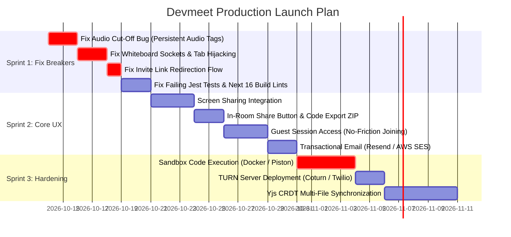

Viewed Navbar.jsx:1-100
Viewed Navbar.jsx:101-150
Viewed login-form.jsx:90-140
Viewed login-form.jsx:160-200
Viewed page.jsx:101-200
Viewed room.service.js:1-44
Viewed page.jsx:440-520
Searched for "join-call"
Viewed page.jsx:1400-1475
Searched for "startCall("
Viewed page.jsx:690-710
Viewed page.jsx:1535-1560
Viewed WorkspaceControlBar.jsx:1-100
Searched for "isScreenSharing"
Searched for "<WorkspaceControlBar"
Viewed page.jsx:2360-2384
Searched for "viewMode ==="
Searched for "setViewMode"
Viewed page.jsx:1570-1650
Viewed page.jsx:1651-1750
Viewed page.jsx:1900-2050
Viewed page.jsx:2051-2150
Viewed page.jsx:2151-2250
Viewed page.jsx:2251-2350
Searched for "<audio"
Searched for "<audio"
Viewed WorkspaceVideoSidebar.jsx:1-60
Viewed WorkspaceVideoSidebar.jsx:120-165
Searched for "@media"
Searched for "download"
Searched for "beforeunload"
Searched for "navigator.clipboard"
Searched for "copy"
Viewed useUserMedia.js:1-100

# DEVMEET: Commercial Product Audit & Launch Readiness Blueprint

If your goal is to launch **DEVMEET** as an actual commercial product that real developers, technical recruiters, and engineering teams will use and pay for, we need to examine it beyond code syntax.

We must evaluate it from the perspective of **user acquisition, first-run user experience (FTUX), real-world network edge cases, scalability, and security.**

---

## 1. Executive Product Assessment

| Dimension                             |  Rating  | Commercial Reality                                                                                                                                     |
| :------------------------------------ | :------: | :----------------------------------------------------------------------------------------------------------------------------------------------------- |
| **Visual Aesthetics & Landing Craft** | **9/10** | **Impressive.** The Linear/GitHub Universe design, Torus gyroscope, and dither shaders create a compelling first impression.                           |
| **Lobby Pre-Meeting Experience**      | **8/10** | **Solid.** Audio visualizer and device enumeration give a professional feel before entering a room.                                                    |
| **Core Collaboration Engine**         | **2/10** | **Not Production-Ready.** Text synchronization lacks real CRDTs; typing overwrites colleagues' code, and tab changes force-switch views for all users. |
| **Media Transport (Audio/Video)**     | **3/10** | **Critical Defect.** Turning off your camera **cuts off your microphone completely** due to conditional unmounting of media elements.                  |
| **Virality & Sharing Loops**          | **2/10** | **Broken.** Invite links drop the room parameter if the recipient is logged out; no guest access exists.                                               |
| **Infrastructure & Security**         | **1/10** | **High Risk.** The code runner executes directly on the host operating system with shell execution enabled.                                            |

---

## 2. The 7 Fatal Launch Blockers (Users Will Churn Immediately)

```
┌────────────────────────────────────────────────────────────────────────┐
│                   SEVEN CRITICAL PRODUCT FAILURES                      │
├────────────────────────────────────────────────────────────────────────┤
│ 1. Sign-Up Trap: Mailtrap sandbox prevents real emails from arriving.  │
│ 2. Audio Cut-Off: Turning camera off unmounts audio stream.           │
│ 3. Broken Invites: Clicking invite link redirects to empty dashboard.  │
│ 4. Host Security: Arbitrary code execution can wipe the server.       │
│ 5. Collision Typing: Raw WebSocket string sync overwrites code.        │
│ 6. Silent Whiteboard: Backend drops canvas drawing events.             │
│ 7. Friction Wall: Guests cannot join without mandatory registration.   │
└────────────────────────────────────────────────────────────────────────┘
```

---

### 🚫 Blocker 1: The "Sign-Up Trap" (100% of New Organic Users Fail)

- **The Code:** [backend/.env:11-14](file:///c:/Users/siddh/OneDrive/Documents/Desktop/Devmeet2/backend/.env#L11-L14)
- **What Happens:** The backend is configured to use `sandbox.smtp.mailtrap.io`. Mailtrap is a developer sandbox that **intentionally captures and traps emails in a developer portal**. It **never delivers messages to real inboxes**.
- **The User Experience:** A user lands on your site, enters `john@acme.com`, and clicks **Send Code**. They wait, refresh, check spam, and receive nothing. **Your conversion rate is currently 0%.**
- **The Fix:** Switch immediately to a transactional provider (**Resend**, **Postmark**, or **AWS SES**) with verified DKIM/SPF domain records. For local demo purposes, add an environment variable flag (`BYPASS_OTP_FOR_DEMO=true`) that auto-fills or prints the OTP.

---

### 🚫 Blocker 2: The "Camera Off = Total Silence" Audio Defect

- **The Code:** [workspace/page.jsx:2258-2270](file:///c:/Users/siddh/OneDrive/Documents/Desktop/Devmeet2/frontend/src/app/workspace/page.jsx#L2258-L2270) & [WorkspaceVideoSidebar.jsx:170-190](file:///c:/Users/siddh/OneDrive/Documents/Desktop/Devmeet2/frontend/src/components/workspace/WorkspaceVideoSidebar.jsx)
- **What Happens:** In WebRTC, an incoming `MediaStream` contains both audio and video tracks. When a peer turns off their camera (`mediaState.isCameraOff = true`), the component conditionally unmounts the `<video>` element to display an avatar placeholder:
  ```jsx
  {
    showVideo ? (
      <video
        ref={(el) => {
          if (el) el.srcObject = peer.stream;
        }}
        autoPlay
        playsInline
      />
    ) : (
      <div className="avatarPlaceholder">...</div> // <--- <video> unmounts, audio cuts off
    );
  }
  ```
  Because there is **no separate `<audio>` tag in the DOM**, the browser ceases audio playback.
- **The User Experience:** A colleague turns off their camera to save bandwidth or because they are typing. **Their voice cuts off completely.** To hear them speak, they must keep their webcam on.
- **The Fix:** Add a persistent, invisible `<audio autoPlay playsInline />` element for every connected peer, independent of video state:
  ```jsx
  <audio
    ref={(el) => {
      if (el && el.srcObject !== peer.stream) el.srcObject = peer.stream;
    }}
    autoPlay
    playsInline
  />
  ```

---

### 🚫 Blocker 3: The Invite Link "Black Hole"

- **The Code:** [frontend/src/middleware.js:16-19](file:///c:/Users/siddh/OneDrive/Documents/Desktop/Devmeet2/frontend/src/middleware.js#L16-L19) & [login-form.jsx:165-170](file:///c:/Users/siddh/OneDrive/Documents/Desktop/Devmeet2/frontend/src/components/login-form.jsx#L165-L170)
- **What Happens:**
  1. Alice starts a room: `devmeet.com/workspace?room=491024`.
  2. She shares the link with Bob on Slack.
  3. Bob is not logged in. `middleware.js` redirects him to `/login` **without preserving the query parameters** (e.g., `?redirect=/workspace?room=491024`).
  4. Bob logs in. `login-form.jsx` runs `window.location.href = "/dashboard"`.
  5. Bob lands on an empty dashboard. Alice's room code is gone.
- **The User Experience:** The primary viral loop of the product is broken. Users must manually copy and paste the room ID after logging in.
- **The Fix:**
  1. In `middleware.js`, append `?redirect=${encodeURIComponent(request.nextUrl.pathname + request.nextUrl.search)}`.
  2. In `login-form.jsx`, redirect to `searchParams.get("redirect") || "/dashboard"`.

---

### 🚫 Blocker 4: Host Remote Code Execution Vulnerability

- **The Code:** [backend/src/modules/room/room.controller.js:158-214](file:///c:/Users/siddh/OneDrive/Documents/Desktop/Devmeet2/backend/src/modules/room/room.controller.js#L158-L214)
- **What Happens:** When a user clicks **Run Code**, the backend writes the file to disk and executes:
  ```javascript
  if (process.platform === "win32") execOptions.shell = true;
  execFile(executablePath, args, execOptions, ...);
  ```
  There is **zero isolation**: no Docker container, no memory quotas, and no network blocking.
- **The Security Threat:** Any user can submit:
  ```python
  import os, urllib.request
  os.system("rm -rf /") # or curl malicious scripts, or exfiltrate process.env containing MONGODB_URI
  ```
  On Windows or Linux, this executes with the permissions of the Node.js process. **Within 24 hours of launch, the server can be compromised or hijacked.**
- **The Fix:** Route execution through an isolated container environment or use a managed sandboxing engine like **Piston API** or **Judge0**.

---

### 🚫 Blocker 5: Fake CRDT & Concurrency Collisions

- **The Code:** [workspace/page.jsx:1091-1110](file:///c:/Users/siddh/OneDrive/Documents/Desktop/Devmeet2/frontend/src/app/workspace/page.jsx#L1091-L1110)
- **What Happens:**
  1. Every keystroke triggers `socket.emit("files-change", { files: updated, activeFileIndex })`.
  2. The backend performs a full MongoDB write (`Room.findOneAndUpdate`) on every keystroke.
  3. If Alice and Bob type simultaneously, Alice's full-string payload overwrites Bob's edits.
  4. **Active Tab Hijacking:** When Alice clicks `index.ts`, `files-update` triggers on Bob's screen with `activeFileIndex`, forcefully switching Bob's active editor view.
- **The Fix:**
  1. Decouple `activeFileIndex` from peer socket events so users can look at different files independently.
  2. Debounce database updates (e.g., save to MongoDB every 3–5 seconds or on blur).
  3. Integrate the Yjs provider from [ExperimentalYjsEditor.jsx](file:///c:/Users/siddh/OneDrive/Documents/Desktop/Devmeet2/frontend/src/components/ExperimentalYjsEditor.jsx) directly into the main workspace.

---

### 🚫 Blocker 6: The Whiteboard Does Not Sync

- **The Code:** [WorkspaceWhiteboard.jsx:117-124](file:///c:/Users/siddh/OneDrive/Documents/Desktop/Devmeet2/frontend/src/components/workspace/WorkspaceWhiteboard.jsx#L117-L124) vs [backend/src/socket/index.js](file:///c:/Users/siddh/OneDrive/Documents/Desktop/Devmeet2/backend/src/socket/index.js)
- **What Happens:** The whiteboard emits `whiteboard:draw` and `whiteboard:clear`. The backend has **zero listeners** for these events.
- **The User Experience:** The drawing board works locally, but remote peers see a blank canvas.

---

### 🚫 Blocker 7: Mandatory Registration Wall for Guests

- **The Code:** [backend/src/socket/index.js:39-41](file:///c:/Users/siddh/OneDrive/Documents/Desktop/Devmeet2/backend/src/socket/index.js#L39-L41)
- **What Happens:** Socket.IO requires a signed JWT access token. Unauthenticated users cannot connect.
- **The Product Problem:** In Google Meet, Zoom, or CodeSandbox, interviewees and guests do not want to create an account, verify an email OTP, and fill out a profile just to attend a 45-minute technical screen.
- **The Fix:** Introduce an **Anonymous Guest Session Token**:
  - Guest enters room URL -> Prompt: _"Enter your name to join"_ -> Server signs an ephemeral JWT (`role: "guest"`, `roomId: "..."`, `expiresIn: "6h"`).

---

## 3. Product Polish & Missing V1 Features

To compete effectively with platforms like Google Meet, Tuple, or Codestr, the following gaps need to be addressed:

### 1. In-Room "Copy Meeting Link" Button

Once inside `/workspace?room=123456`, there is **no button to copy the room link or invite a peer**. The host must manually copy the URL from their browser's address bar.

- **Fix:** Add a persistent `Copy Meeting Link` button in the top navigation and control bar with a confirmation toast.

### 2. Code Export & Download

There is currently no way to export session code. When a 60-minute interview concludes, users have no export mechanism.

- **Fix:** Add an **Export Files** button that bundles active files into a `.zip` or copies the current file to the clipboard.

### 3. Screen Sharing Implementation

[WorkspaceControlBar.jsx](file:///c:/Users/siddh/OneDrive/Documents/Desktop/Devmeet2/frontend/src/components/workspace/WorkspaceControlBar.jsx#L81) contains a UI slot for screen sharing, but the `isScreenSharing` and `toggleScreenShare` props are **never passed from `workspace/page.jsx`**. The feature is currently non-functional.

- **Fix:** Wire up `navigator.mediaDevices.getDisplayMedia({ video: true, audio: true })` and replace the peer connection video track.

### 4. Unread Chat Indicator

The unread message badge in [WorkspaceControlBar.jsx](file:///c:/Users/siddh/OneDrive/Documents/Desktop/Devmeet2/frontend/src/components/workspace/WorkspaceControlBar.jsx#L34) is hardcoded to `unreadCount={0}`. When users focus on code and the chat drawer is closed, they miss incoming messages.

- **Fix:** Increment an `unreadCount` state whenever `receive-message` fires while `sideDrawer !== "chat"`.

### 5. Accidental Tab Close Warning (`beforeunload`)

If a participant accidentally closes their tab or swipes back, they drop from the call with no confirmation prompt.

- **Fix:** Add a `window.addEventListener("beforeunload", ...)` guard while inside an active room session.

### 6. TURN Server Configuration (18% Black Screen Failure Rate)

[workspace/page.jsx:29-35](file:///c:/Users/siddh/OneDrive/Documents/Desktop/Devmeet2/frontend/src/app/workspace/page.jsx#L29-L35) only configures Google STUN servers. STUN cannot traverse symmetric NATs or corporate firewalls.

- **Fix:** Add a Coturn instance or managed TURN service (e.g., Twilio or Metered.ca) to ensure connections succeed across all networks.

---

## 4. End-to-End User Journey: Current vs. Target

```
CURRENT FLOW (Broken User Experience)
[User visits Landing Page]
       │
       ▼
[Signs up with Email] ──► [Trapped in Mailtrap: No OTP received] (Drop-off 1)
       │
       ▼ (if using Google OAuth)
[Enters Dashboard] ──► [Creates Session & types colleague email]
       │                 (Backend drops email, nothing is sent)
       ▼
[Enters Workspace] ──► [No button to copy room link]
       │
       ▼ (Manually shares URL)
[Colleague clicks URL] ──► [Redirected to /login without redirect param]
       │                 (Lands on empty dashboard, loses room) (Drop-off 2)
       ▼ (Colleague manually finds room)
[Both in Workspace] ──► [Colleague turns off camera -> Voice cuts off] (Drop-off 3)
       │
       ▼
[Alice switches tab] ──► [Forces Bob's editor to switch tabs too]
       │
       ▼
[Both type code] ──► [Typing collision overwrites code; DB chokes]
```

```
TARGET FLOW (Commercial Production Grade)
[User visits Landing Page]
       │
       ▼
[One-Click Sign In (Google / GitHub) OR Instant Guest Join]
       │
       ▼
[Green Room Lobby: Mic Level Check & Video Preview]
       │
       ▼
[Enters Workspace] ──► [One-click "Copy Invite Link" with toast]
       │
       ▼
[Colleague clicks Link] ──► [Joins directly (or prompts for name if guest)]
       │
       ▼
[WebRTC Mesh + TURN Relay + Background Audio Tags]
  • Audio works continuously regardless of camera state
  • Real Yjs CRDT: Remote cursors, independent file browsing
  • Whiteboard events sync across peers
  • Secure code execution via isolated sandbox
       │
       ▼
[Session End: One-click "Download Code ZIP" & saved to session history]
```

---

## 5. Prioritized Sprint Plan to Reach Launch Quality



---

## 6. Recommended Next Step

To make this product usable and launch-ready, I recommend we address the **most critical issues in order of impact**:

1. **Step 1:** Fix the **audio cut-off defect** so remote audio works continuously when webcams are toggled.
2. **Step 2:** Wire up the **whiteboard socket relay** in the backend so drawings sync between users.
3. **Step 3:** Fix the **invite link redirect flow** in `middleware.js` and `login-form.jsx`.
4. **Step 4:** Decouple **editor tab switching** so users can browse different files independently.
5. **Step 5:** Fix the **7 failing backend tests** and **React 19 build errors** so continuous deployment runs cleanly.

Let me know which step you would like to tackle first, and we can begin applying the fixes.
